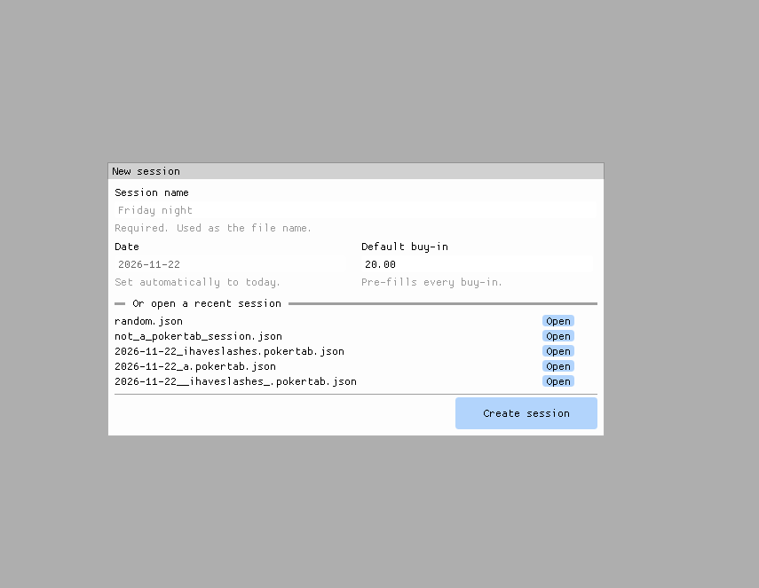
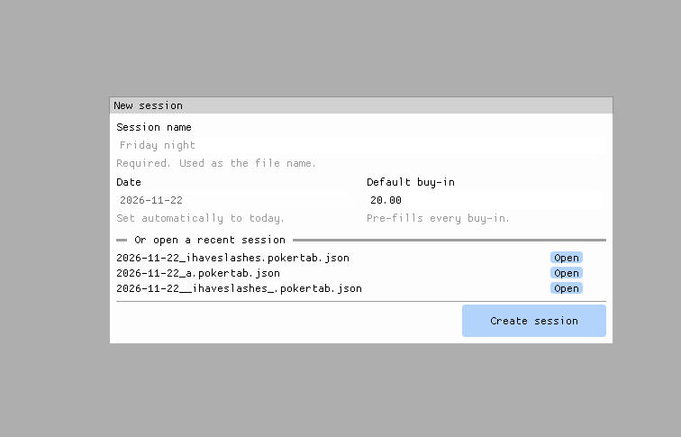

# Eric Miao

**Name of person who fixed bug:** Eric Miao
**Bug that was fixed #1:** All .json files in the session directory is shown in recent sessions, not just .pokertab.json

-Issue:[Github Issue #102] (https://github.com/HiddenOffset/PokerTab-Group15/issues/102)
-Pull Request #104: [https://github.com/HiddenOffset/PokerTab-Group15/pull/104]
-Severity: [Medium]
-Priority: [Low]

#Before the fix

#After the fix

**Type of Bug**: This is a code bug, specifically a logic bug where it earlier has been decided that all files will be .pokertab.json but instead the filter filters for all .json, which is overinclusive. 
**AI Disclosure:** Codex was used to assist in finding the least intrusive fix for the bug. 

**Name of person who fixed bug:** 
**Bug that was fixed #2:** 
-Issue:[Github Issue #0] (https://github.com/HiddenOffset/PokerTab-Group15/issues/0)
-Pull Request #0:[https://github.com/HiddenOffset/PokerTab-Group15/pull/0]
-Severity: [_]
-Priority: [_]

#Before the fix

#After the fix

**Type Of Bug**: 

**AI Disclosure:** 
