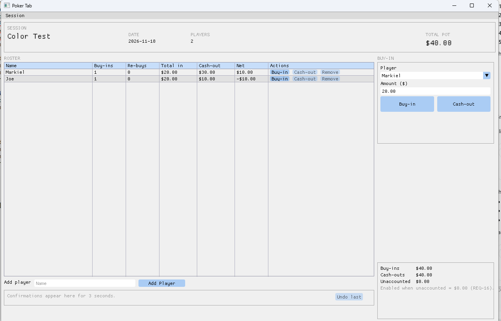
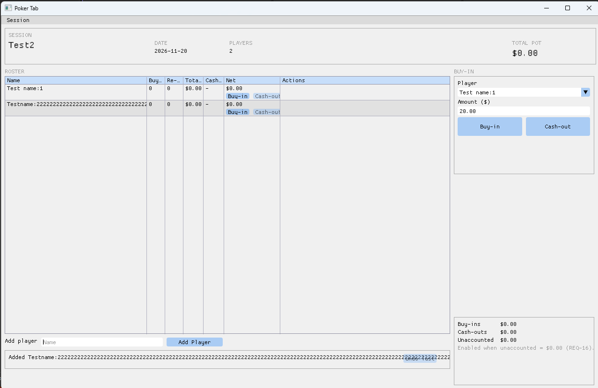
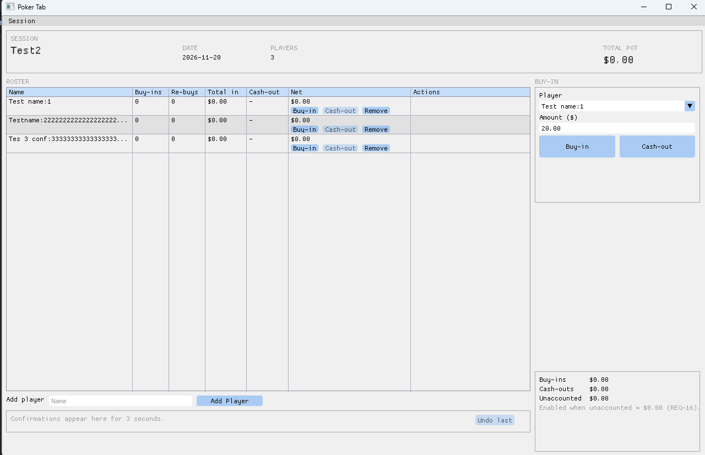

# Mason Randall

**Name of person who fixed bug:** Mason Randall
**Bug that was fixed #1:** Positive dollar amounts are colored green while negative dollar amounts are colored red

-Issue:[Github Issue #76] (https://github.com/HiddenOffset/PokerTab-Group15/issues/76)
-Pull Request #92: [https://github.com/HiddenOffset/PokerTab-Group15/pull/92]
-Severity: [Low]
-Priority: [Low]

#Before the fix

#After the fix

**Type of Bug**: This type of bug is a code bug as the app did not match what the documentation and testing it I found it was not there.
***AI Disclosure:** I used ChatGPT to help me write a mock test to help me test the fix for my bug

**Name of person who fixed bug:** Mason Randall
**Bug that was fixed #2:** Fixing the name issue so that long names end with "..."
-Issue:[Github Issue #62] (https://github.com/HiddenOffset/PokerTab-Group15/issues/62)
-Pull Request:[https://github.com/HiddenOffset/PokerTab-Group15/pull/93]
-Severity: [Low]
-Priority: [Low]

#Before the fix

#After the fix

**Type Of Bug**: This was a code bug because the app did not have the behavior that the write up had I then confirmed this bug by opening it on my own comptuer and then fixed it from there.

**AI Disclosure:**ChatGPT helped with syntax and helping make sure I did not make any errors that could possible break my app.