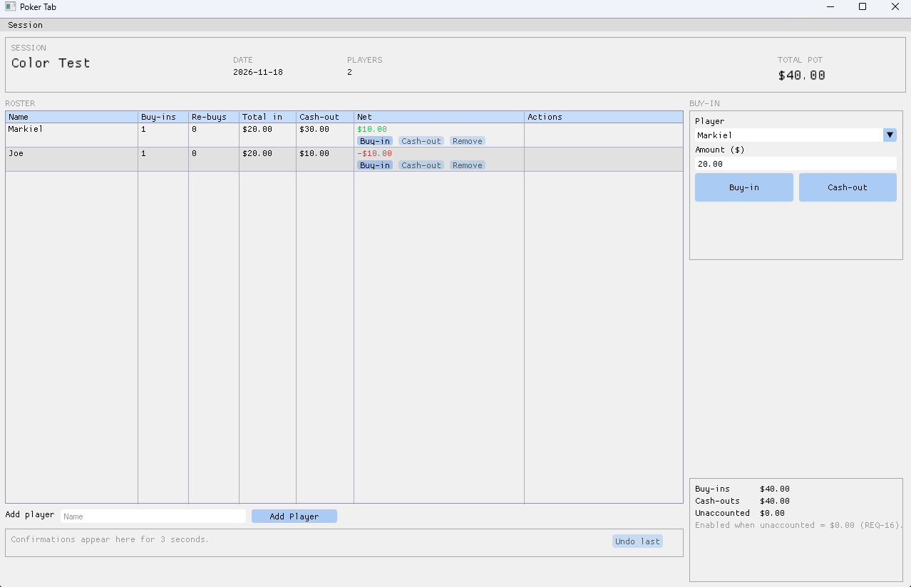

**Name of person who fixed bug:** Mason Randall
**Bug that was fixed #1:** Positive dollar amounts are colored green while negative dollar amounts are colored red

-Issue:[Github Issue #76] (https://github.com/HiddenOffset/PokerTab-Group15/issues/76)
-Pull Request: [Github Pull Request #TBD]
-Severity: [Low]
-Priority: [Low]

#Before the fix

#After the fix

**Explanation** The bug that was fixed was adding color to the dollar amounts in the poker tab. The positive dollar amounts are now colored green while the negative dollar amounts are colored red. This was done to make it easier for users to quickly identify their gains and losses while using the application.
**AI Disclosure:** I used ChatGPT to help me write a mock test to help me test the fix for my bug
