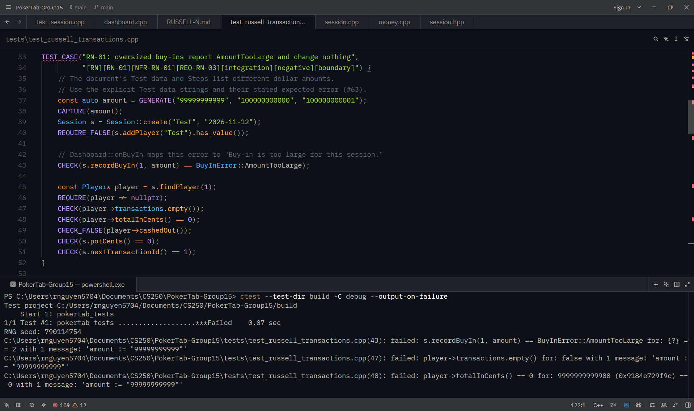
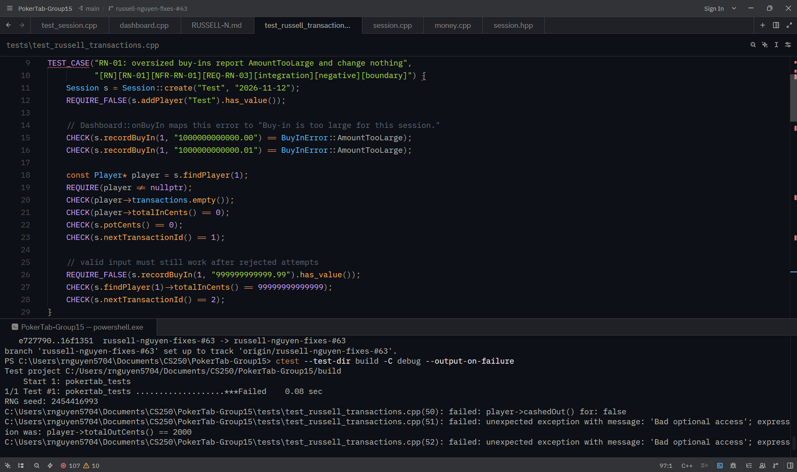

# Russell Nguyen

**Name of person who fixed bug:** Russell Nguyen
**Bug that was fixed #1:** Buy-in bugs out on $1,000,000,000,000+

-Issue:[Github Issue #63] (https://github.com/HiddenOffset/PokerTab-Group15/issues/63)
-Pull Request #97: [https://github.com/HiddenOffset/PokerTab-Group15/pull/97]
-Severity: [Low]
-Priority: [Low]

#Before the fix

#After the fix

**Type of Bug**: This is a code bug as the error type being thrown did not match the error type that was supposed to be thrown and what a user would expect either.
**AI Disclosure:** Codex wrote automated test cases that were manually modified and helped figure out the regular expression statement to differentiate actual invalid amounts and simply overly large inputs.

**Name of person who fixed bug:** Russell Nguyen
**Bug that was fixed #2:** Cash-out button is unresponsive
-Issue:[Github Issue #94] (https://github.com/HiddenOffset/PokerTab-Group15/issues/94)
-Pull Request #98:[https://github.com/HiddenOffset/PokerTab-Group15/pull/98]
-Severity: [High]
-Priority: [High]

#Before the fix

#After the fix

**Type Of Bug**: This was a code bug because the button for cashing out on the UI did nothing, which is something the user would expect when clicking on the "Cash-out" button.

**AI Disclosure:** Codex generated automated tests that were then manually modified to be more accurate.
